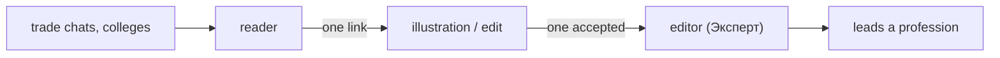

# Community plan

The founder develops the platform and coordinates; content comes from practitioners.
This page is the plan for getting there. Settled calls are in
[decisions/2026-10-13-community-doors](decisions/2026-10-13-community-doors.md).

## The funnel

Readers → one-link contributors → editors → authors, at roughly 100 : 10 : 1. No in-app
mechanic produces contributors from zero readers, so acquisition comes first and the app
only removes friction on arrival.

## In the app

| Door | Where | State |
|---|---|---|
| Public illustration queue | `/illustrations`, home nudge, footer, `/contribute` | shipped 2026-10 |
| Suggest an illustration by link | placeholder in the lesson, queue | shipped 2026-10 |
| Recent changes feed with authors | `/changes`, footer, `/contribute` | shipped 2026-10 |
| Lower first step for editors | grant on one accepted edit + a message, not an application | next |
| Lighter application | rename «вести профессию» to «хочу помочь», one field | next |
| External chat «Цех» | `t.me/industrialprofi`; footer, `/contribute`, `/illustrations` | shipped 2026-10 |

Constraints: no member uploads, no leaderboard, no in-app chat, no new roles.

## Outside the app

1. **Go where electricians are.** Five to ten trade chats and forums, with a concrete
   ask from the queue («не хватает фото вот этих 12 вещей»), not «join our community».
2. **The Telegram group «Цех»** (`t.me/industrialprofi`). Out-of-band, so it does not
   contradict [no realtime chat](decisions/2026-06-24-no-realtime-chat.md). No topics
   until ~50 active people; talk about the trade is welcome, not only about the site; the
   founder posts daily at first and thanks every contributor by name. Ten live people
   end the empty-room effect.
3. **Wikimedia Commons as a source.** CC BY-SA compatible; «find the right Commons image»
   is a five-minute task anyone can do and the founder can batch alone.
4. **Humanise the founder, not the logo.** Name, face and «пишу — отвечаю» on `/about`;
   no redesign.
5. **Grant editor rights early.** One accepted contribution and a personal message.

## Measuring

Count outside contributions per month on the two queues (feedback with the illustration
header, revisions with an `editor_name`). The [users-before-features](decisions/2026-09-21-users-before-features.md)
number — week-two returns on one profession — stays the primary metric.
