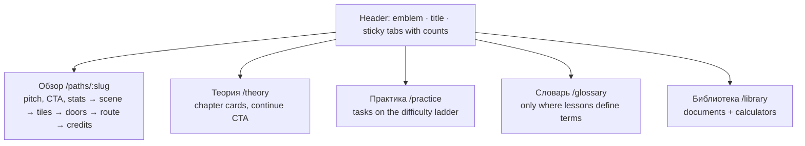

# Profession hub

- **Header** (`paths/_hub_header`): the overview carries the pitch — description, the start
  button, three stats; every other tab gets one compact title row so its content starts on
  the first screen. The tab row is sticky and shows counts from `Path::Inventory`, the one
  place that counts chapters, lessons, tasks, documents, calculators and terms.
- **Overview order** (`paths/_landing`): scene → first paragraph of «О профессии» (the rest
  behind «Читать дальше») → highlights as tiles (`**Навык:** пояснение` splits into title and
  small print) → doors into the tabs → the chapter route → pros/cons → FAQ → history → the
  start button again → credits (curators, contributors, maturity). The doors and the route
  render for every profession; the slots only when filled.
- **Scene** (`paths/scenes/_<slug>`, `scene-<slug>.css`, shared `scene.css`): the animated
  drawing that opens the overview — an inline SVG telling one working situation on a
  10–12 s lap, a line that narrates its three phases, and six legend chips that open the
  chapters and light their part of the drawing on hover. Drawn by a developer, one partial
  and one stylesheet per profession; the shared pen (`art-*` classes) keeps them in one
  hand. Words live in `paths.scenes.<slug>`. A profession without a partial has no scene.
  Not editable in the admin on purpose: a form would cap every scene at one generic
  layout, and pasted markup would be stored script on a public page. The brief for
  drawing one is `tools/PROFESSION_SCENE.md`.
- **One scene, two places**: the partial takes `mode:` — `:full` on the overview (drawing,
  phases, legend) and `:poster` on the catalog card (a crop of the drawing frozen `--poster`
  seconds into its lap, running on hover). `uid:` keeps SVG ids apart when a scene is drawn
  twice on a page. A profession without a scene gets an emblem poster.
- **Home hero** (`paths/index`, `home.css`): a heading, one button, the sheet, one status
  line. The heading is set in the drawing's GOST face and types itself once per browser
  session (`typed_heading` puts each letter in a span, CSS types them, the `typed`
  controller remembers the session). A «Профессии» heading and breathing room separate
  the sheet from the catalog cards.
- **Home sheet** (`paths/_blueprint`, `paths/blueprint/*`, `blueprint.css`): one drawing that
  belongs to no single profession — a power panel, a control cabinet and a pump on drawing
  paper. The parts are partials laid out twice: a portrait sheet for phones and a
  landscape one from 64em, where the pump is drawn 1.6× as the subject; CSS shows one.
  Professions hang on it as callouts (`PathsHelper::BLUEPRINT_SLOTS` maps a slug to its
  place; one without a place lives in the catalog only).
- **The sheet is a game** (`plant` Stimulus controller): the visitor presses the parts
  themselves — the supply, control and motor breakers, the valve, «Пуск». An orange
  marker arrow (`data-next`) points at the next part; the controller keeps the state as
  data attributes on the figure and `blueprint.css` draws each one. A start with the valve
  shut, or shutting it on the run, trips the dry-run protection; every refusal says why
  and links to the profession that explains it. The result line gives the time and the
  attempt, then «how it works», share (Web Share, else the clipboard) and «again».
  Without JS the sheet simply runs. Metrika goals: `plant_started`, `plant_launched`,
  `link_copied`.
- **Landing «О профессии»** (`Path::Landing`): six slots in one JSON column
  (`paths.landing`: about/history/faq markdown; highlights/pros/cons line lists) +
  `has_one_attached :cover` (also the og:image). Carried by packs as `landing.yml` +
  `cover.*`; frozen by an expert's edit, but an empty landing is filled even on a
  human-owned profession (`Path#fill_landing`). National specifics live in prose; a new
  slot becomes code only when two professions ask.
- **Hobby shelf**: `paths.field` is `industry` or `hobby` (`field:` in `path.yml`).
  Hobby maps render in `.catalog-hobby` between the grid and «В планах», never in the main grid or
  dashboard suggestions — see [the decision](../decisions/2026-09-27-hobby-shelf.md).
  Outside the import digest, so adding it froze nothing.
- **Unlisted**: `Path.in_catalog` (published and `listed`) feeds the catalog, dashboard
  suggestions, practice, library, glossary, changes feed and calculator index; an unlisted
  hub and its lessons stay public with a notice. The journal form keeps every profession so
  existing entries stay editable. `listed:` in `path.yml` applies only on create — after that
  the admin checkbox owns it. See
  [the decision](../decisions/2026-11-01-focus-two-professions.md).
- **Glossary**: `GlossaryTerm` rows are owned by the lesson that explains each term,
  edited next to its links, `terms:` in pack frontmatter.
- `Path::Progress` is the per-reader null object the hub reads — no `Current.user`
  branching in views.
- The old `?path=` views of `/projects`, `/resources`, `/glossary` 301 into the hub; the
  site-wide pages stay in the footer and palette. Every tab ends in «Улучшить карту».
- **Projects** (`/projects`): all `kind: practice` lessons across published paths with
  difficulty filters.
- **Calculators** (`/calculators`): a code registry (no DB) + one Stimulus controller for
  all the math.
- **Resources** carry `country_code` (nil = universal) — one lesson, different documents
  per country.
